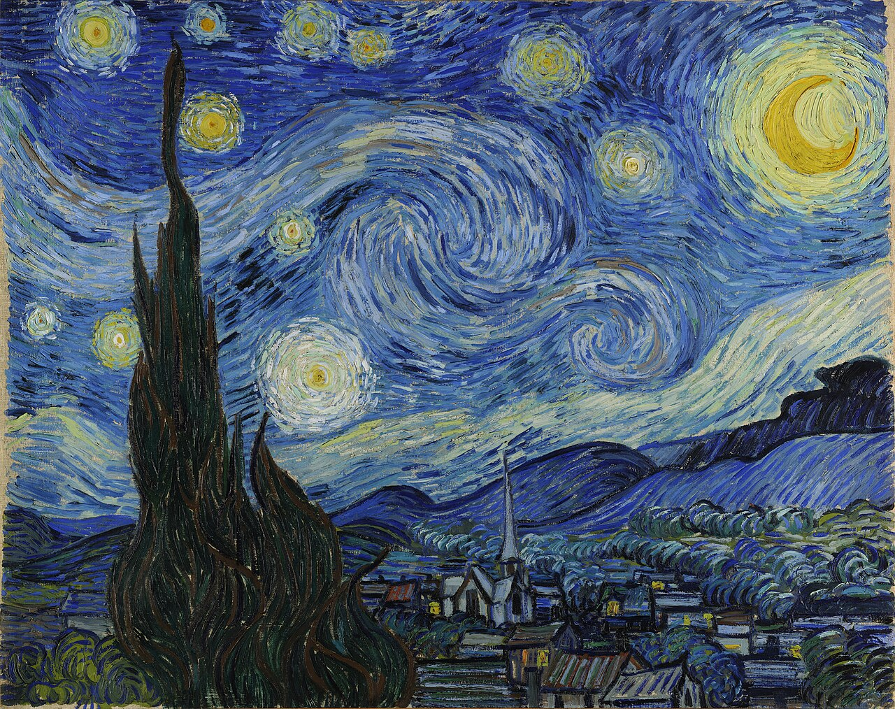
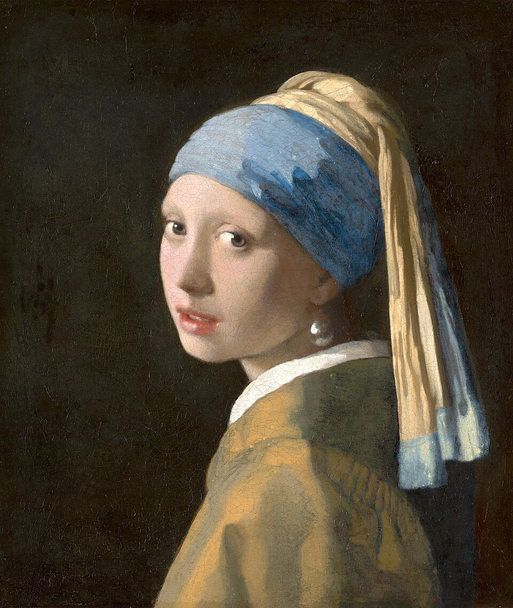
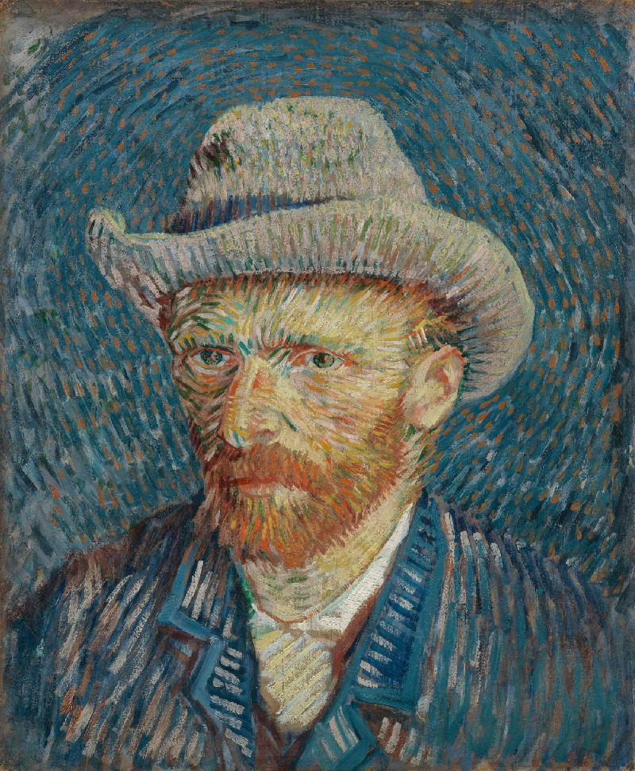

# PrettyColors

Have you ever thought your plots don't represent you?
Have you ever wanted to sneak a picture of your dog into your scientific work?

PrettyColors is a solution to a problem you didn't know you had. You just need to feed it an image, and it will output the most major colors from that image that you can use in a plot!

**Status: Very much beta.** It works, but needs more work. See [Known limitations](#known-limitations).

## Examples

Each row shows the source image, 5 line colors from `line_colors`, and a sequential colormap from `sequential_colors`.

| Image | Line colors and sequential colormap |
|:---:|:---|
|  | <br> |
|  | <br> |
|  | <br> |
|  | <br> |


## How it works

Pixels are first converted from an RGB space to a CIELAB space (to match how the eye perceives color differences). Using a k-means clustering on the pixels, we group pixels into different colors and then drop colors that are too close by on the CIELAB space. The remaining colors are then sorted by lightness to produce a list with different hex values or a matplotlib colormap object.

## Usage

You need Python 3 with these packages:
 
```
pip install numpy pillow matplotlib
```

Clone the repo and run from inside the folder:

```python
import matplotlib.pyplot as plt
from extract import line_colors, sequential_colors

colors = line_colors("examples/img/Starry_Night.jpg", 5)   # list of 5 hex codes
cmap = sequential_colors("examples/img/Starry_Night.jpg")  # matplotlib colormap

plt.plot(x, y, color=colors[0])   # use with your own data
plt.imshow(data, cmap=cmap)
```

Both functions show a preview; pass `preview=False` to skip it.

## Known limitations

- Line palettes can include light colors that would be a no-no for a white background (see Jackie).
- Sequential colormaps need work.
- Colors can't be saved (yet).

## Image credits

- Vincent van Gogh, *The Starry Night* (1889), public domain
- Johannes Vermeer, *Girl with a Pearl Earring* (c. 1665), public domain
- Vincent van Gogh, self-portrait (1887), public domain
- Jackie, my dog (photo by me)